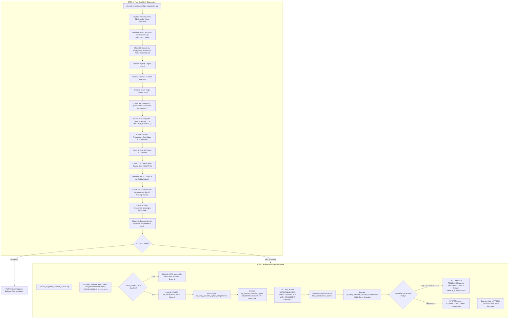

# MarkHub – Phase 1: Database Migration Execution Plan (V5.6 Final Critical Defect Correction)
**Unified UG + PG Architecture Integration – NOV/DEC 2026 Assessment Cycle**  
**Target Sandbox Schema:** `college_cms_verify`  
**Execution Status:** `PREPARATION ONLY (AWAITING EXPLICIT USER AUTHORIZATION)`  
**Date:** 2026-11-09  

---

## 1. Executive Summary & Defect Closure Scope

This **V5.6 Final Critical Defect Correction Execution Plan** provides the complete operational and technical specification for the unified UG + PG MarkHub architecture migration, addressing all four critical review requirements:

1. **Session Identity Protection with Non-NULL Guard (`phase1_database_migration.sql` & `phase1_migration_validation.sql`)**:
   - In MySQL InnoDB, a composite `UNIQUE` index that includes nullable columns (`academic_year_id`, `assessment_cycle_id`) permits multiple duplicate rows when any indexed column is `NULL` because `NULL = NULL` evaluates to `UNKNOWN`.
   - Corrected by defining the composite unique constraint `uq_marks_sessions_identity` on `(`session_identity_guard`, `class_id`, `subject_id`, `session_label`)`.
   - The stored generated column `session_identity_guard` maps NULL `academic_year_id` and `assessment_cycle_id` to `'__UNRESOLVED_AY__:__UNRESOLVED_CYCLE__'` and resolved sessions to `'<ay_id>:<cycle_id>'`.
   - Because `session_identity_guard` is **100% NON-NULL**, duplicate session identities are strictly rejected for both historical and active sessions.
   - Historical session 1 remains preserved in unresolved state with `academic_year_id = NULL` and `assessment_cycle_id = NULL`; no synthetic historical AY or cycle values are invented.
2. **Operationally Enforceable Write-Free Maintenance Procedure (`phase1_migration_preflight_diagnostics.sql`, `phase1_migration_baseline_capture.sql`, and `phase1_database_migration.sql`)**:
   - Operator session variables (`@OPERATOR_ENFORCED_WRITE_FREE_MAINTENANCE_WINDOW`) provide no physical write concurrency protection.
   - Implemented an operationally enforceable procedure:
     1. *Application Service Isolation*: External write traffic and background queues are stopped (`pm2 stop college-cms-backend`, Docker container stop, or disabling reverse-proxy upstream routing).
     2. *Server-Level Read-Only Mode*: Enabling global read-only mode (`SET GLOBAL read_only = ON; SET GLOBAL super_read_only = ON;`) if executing with a dedicated administrative user.
     3. *Pre-Execution Thread Audit*: Programmatically auditing `information_schema.PROCESSLIST` to verify zero concurrent active client connections targeting `college_cms_verify` (excluding `CONNECTION_ID()` and sleeping/system threads).
     4. *Pre-Execution Transaction Audit*: Programmatically auditing `information_schema.innodb_trx` to verify zero active uncommitted background InnoDB transactions.
     5. *Continuous Write Freeze*: Maintenance window remains strictly active from preflight diagnostics through post-migration validation until `phase1_migration_validation.sql` emits GREEN.
3. **Reliable Baseline Failure Recovery & Non-Destructive Workflow (`phase1_migration_baseline_capture.sql`)**:
   - Status record with `status = 'IN_PROGRESS'` is committed to `migration_baseline_capture_status` **before** initiating the snapshot transaction.
   - Hash capture and verification are executed inside procedure `sp_execute_baseline_capture` equipped with `DECLARE EXIT HANDLER FOR SQLEXCEPTION`.
   - On runtime failure or interruption, the uncommitted snapshot transaction is rolled back, and the status record is reliably updated to `FAILED_INTERRUPTED` with error details, preventing incomplete captures from being accepted as `COMPLETED`.
   - Re-run safety is non-destructive: existing baseline evidence is never deleted (`DELETE` statements prohibited); retries execute under a distinct `@run_id` (e.g. `_RETRY1`), preserving historical failure forensics.
4. **Conditional Final-State Migration Completion Verification (`phase1_database_migration.sql`)**:
   - Unconditional success messages (e.g. `'COMPLETED SUCCESSFULLY'`) have been removed from Stage 8.
   - Implemented stored procedure `sp_migration_verify_final_state` which programmatically asserts all 9 post-migration invariants: total classes = 33, PG classes = 4, UG classes = 29, unmapped classes = 0, academic programmes = 11, all 4 M.E. classes verified with exact attributes, historical session 1 preserved unresolved with NULL AY and Cycle, unique identity guard constraint active, and active trigger count = 15.
   - If any assertion fails, `sp_migration_verify_final_state` halts via `SIGNAL SQLSTATE '45000'`.
   - The final scorecard evaluates a conditional `CASE` statement emitting `SUCCESS` only when 100% of final-state assertions pass; otherwise it emits `FAIL`.

---

## 2. Decoupled Preflight & Baseline Capture Workflow



---

## 3. Physical Server Safety & Maintenance Window Governance

### 3.1 Limitations of In-Band SQL Environmental Checks
1. **Database Name & Port**: `DATABASE() = 'college_cms_verify'` and `@@port = 3306` do NOT prove that the database is running on a local developer workstation. A cloud VPS or staging instance could share this schema name and listen on standard MySQL ports.
2. **Server Hostname**: An SQL query reading `@@hostname` reflects the operating system hostname of the server daemon, but cannot confirm whether the client's TCP socket is connected to `127.0.0.1` vs. an SSH tunnel or remote network route.
3. **Session Variables Are Not Firewalls**: Setting `@OPERATOR_ENFORCED_WRITE_FREE_MAINTENANCE_WINDOW` in a connection does not stop another client or background job from issuing INSERT or UPDATE commands.

### 3.2 Operationally Enforceable Maintenance Protocol
Before executing any mutating SQL script (`baseline_capture.sql`, `database_migration.sql`, `rollback_and_recovery.sql`), the operator must perform mandatory out-of-band operational isolation:
1. **Application Process Termination**:
   ```bash
   pm2 stop college-cms-backend
   # Or stop docker containers / worker services
   ```
2. **Network / Reverse Proxy Gate**:
   Temporarily route application traffic to an HTTP 503 Maintenance page to prevent incoming write requests.
3. **Client Connection Inspection**:
   Inspect client connection properties to confirm host is strictly `127.0.0.1` or `localhost`.
4. **Session Declarations**:
   ```sql
   SET @OPERATOR_VERIFIED_LOCAL_SANDBOX = 'YES_VERIFIED_LOCAL_SANDBOX';
   SET @OPERATOR_AUTHORIZED_MIGRATION_EXECUTION = 'AUTHORIZED_BY_EXAMINATION_CELL';
   SET @OPERATOR_ENFORCED_WRITE_FREE_MAINTENANCE_WINDOW = 'YES_MAINTENANCE_WINDOW_ENFORCED';
   ```
5. **Programmatic SQL Concurrency Audits**:
   - `information_schema.PROCESSLIST` checked to confirm zero active client threads on `college_cms_verify`.
   - `information_schema.innodb_trx` checked to confirm zero uncommitted transactions.
6. **Continuous Enforcement**:
   Maintenance window remains active through migration handoff until `phase1_migration_validation.sql` verifies complete post-migration integrity with GREEN status.

---

## 4. Baseline Capture Scope, Snapshot Isolation & Exception Handling

### 4.1 Selected-Column Checksums Scope (Explicit Columns Monitored)
The baseline capture establishes a high-fidelity cryptographic integrity gate over the following explicit columns:
- **`students`**: `id, roll_no, name, department, current_semester, status`
- **`student_enrollments`**: `id, student_id, academic_year_id, class_id, semester, attempt_number, transfer_sequence, status, entry_type, is_current, is_verified_entry`
- **`classes`**: `id, name, department, semester, year_label, section, academic_year, batch`
- **`marks_sessions`**: `id, subject_id, class_id, staff_id, session_label, total_max, status, avg_score, student_count`
- **`marks`**: `id, session_id, component_id, student_id, marks_obtained`
- **`assessment_components`**: `id, session_id, type_id, label, conducted_max, max_marks`
- **`session_attendance`**: `session_id, student_id, hours_attended, actual_taken_hours, attendance_mark`

> [!NOTE]
> Columns outside this monitored set (e.g. presentation styling attributes, UI icons, or non-functional auxiliary metadata) are intentionally excluded from the hash payload. The baseline does NOT claim full-row physical byte protection; standard physical backup (`mysqldump`) must be taken prior to migration.

### 4.2 Durable Status Tracking & SQLEXCEPTION Handler
In `phase1_migration_baseline_capture.sql`:
1. `migration_baseline_capture_status` records the run identifier (`@run_id`), machine hostname, active user, and capture timestamp.
2. An initial status record with `status = 'IN_PROGRESS'` is inserted and committed *before* starting the snapshot transaction, ensuring the run attempt is durably recorded even if the transaction subsequently encounters an error.
3. The capture logic is encapsulated inside `sp_execute_baseline_capture` with `DECLARE EXIT HANDLER FOR SQLEXCEPTION`:
   - On any runtime failure, the handler issues `ROLLBACK`, marks the status as `FAILED_INTERRUPTED`, records the failure timestamp and error message, and re-raises `SIGNAL SQLSTATE '45000'`.
   - On full verification success, the status is updated to `COMPLETED` and `COMMIT` is issued.
4. Non-destructive retries: Retrying a baseline run requires setting a new run identifier (e.g. `SET @run_id = 'MARKHUB_AY2026_ODD_SEM1_V5.6_RETRY1';`). Historical run evidence is permanently preserved; no `DELETE` statements are executed against baseline tables.

---

## 5. Stage-by-Stage Migration Execution & Recovery Matrix

| Stage | Operations in Execution Order | Expected Post-Stage State | Potential Failure Point | Partial State Recovery Action |
|---|---|---|---|---|
| **Stage 0: Context & Pre-Checks** | 1. Display connection context.<br>2. `sp_migration_assert_preconditions()` asserting completed baseline, clean columns, zero collisions, maintenance window active, `PROCESSLIST = 0`, `innodb_trx = 0`, 7 depts exist exactly once, and exactly one of each cycle. | Clean connection, completed baseline verified, zero collisions, depts validated, cycles validated, client isolation confirmed. | Remote host, missing baseline, colliding IDs, concurrent clients, uncommitted trx, dept count $\ne 1$, cycle count $\ne 1$. | Terminate session immediately. Zero schema changes occurred. |
| **Stage 1: Academic Programmes** | 1. `CREATE TABLE academic_programmes`<br>2. `INSERT` 11 programmes (7 UG + 4 PG) dynamically joining `departments d ON d.short_name = p.dept_code` | `academic_programmes` exists with exactly 11 rows mapped to verified department IDs. | Department short_name missing or FK failure. | `DROP TABLE IF EXISTS academic_programmes;` |
| **Stage 2: Classes Extension & Mapping** | 1. `ALTER TABLE classes ADD COLUMN...`<br>2. 29 explicit `UPDATE` statements<br>3. `sp_migration_assert_no_unmapped_classes()`<br>4. `INSERT` 4 active M.E. classes | `classes` has 33 rows (29 baseline + 4 PG); zero unmapped classes. | ALTER fails; unmapped class assertion; duplicate class ID. | `DELETE FROM classes WHERE id IN ('ME_CSE_I', 'ME_EST_I', 'ME_SE_III', 'ME_MFE_III');`<br>`ALTER TABLE classes DROP FOREIGN KEY fk_classes_academic_programme, DROP INDEX idx_classes_prog_reg_sem, DROP COLUMN program_code, DROP COLUMN regulation_code, DROP COLUMN program_type;`<br>Follow with Stage 1 recovery. |
| **Stage 3: Session Identity & AY/Cycle** | 1. `ALTER TABLE assessment_cycles ADD UNIQUE KEY...`<br>2. `ALTER TABLE marks_sessions ADD COLUMN academic_year_id, assessment_cycle_id, is_archived, session_identity_guard...`<br>3. `ADD UNIQUE KEY uq_marks_sessions_identity (session_identity_guard, class_id, subject_id, session_label)`<br>4. `UPDATE` session 1 to unresolved state (`is_archived = 1`)<br>5. `ALTER TABLE marks_sessions ADD CONSTRAINT...` | Non-null unique identity guard active; session 1 soft-archived with NULL AY and Cycle; AY/cycle consistency enforced. | Unique constraint failure; duplicate session identity. | Revert session 1 (`is_archived = 0`); drop FKs and check constraint; drop `uq_marks_sessions_identity`; drop columns; drop composite key on `assessment_cycles`. |
| **Stage 4: Marks Soft-Clearing** | 1. `ALTER TABLE marks ADD COLUMN is_cleared...` | Soft-clearing audit columns added; default `is_cleared = 0`. | Column addition interrupted. | `ALTER TABLE marks DROP INDEX idx_marks_active_lookup, DROP COLUMN clear_reason, DROP COLUMN cleared_by, DROP COLUMN cleared_at, DROP COLUMN is_cleared;` |
| **Stage 5: Component Archival** | 1. `ALTER TABLE assessment_components ADD COLUMN is_active...` | Soft-archival audit columns added; default `is_active = 1`. | Column addition interrupted. | `ALTER TABLE assessment_components DROP INDEX idx_components_session_active, DROP COLUMN archive_reason, DROP COLUMN archived_by, DROP COLUMN archived_at, DROP COLUMN is_active;` |
| **Stage 6: Student Eligibility** | 1. `ALTER TABLE student_enrollments ADD COLUMN is_marks_eligible (VIRTUAL), is_promotion_eligible (STORED NULL)...` | Virtual marks eligibility active; promotion eligibility stored nullable. | Column addition interrupted. | `ALTER TABLE student_enrollments DROP INDEX idx_enrollment_hist_report, DROP COLUMN is_promotion_eligible, DROP COLUMN is_marks_eligible;` |
| **Stage 7: Immutability Triggers (15 Triggers)** | 1. Create 15 triggers protecting marks, components, sessions, attendance, history, and audit logs.<br>2. INSERT into archived sessions blocked.<br>3. UPDATEs moving records into archived sessions blocked.<br>4. Archived session modifications strictly blocked. | 15 triggers active in `information_schema.triggers`. | Trigger syntax or privilege failure. | Drop all 15 triggers explicitly. |
| **Stage 8: Final State Verification** | 1. `sp_migration_verify_final_state()` executing 9 mandatory assertions.<br>2. Scorecard query reporting conditional `SUCCESS` or `FAIL`. | Migration verified complete; ready for read-only validation suite. | Count mismatch; assertion failure halts via `SIGNAL 45000`. | Execute full rollback procedure. |

---

## 6. Truly Read-Only Validation Architecture

`phase1_migration_validation.sql` is **100% read-only**:
- **Zero Schema Mutations**: Contains zero `CREATE PROCEDURE`, zero `DROP PROCEDURE`, zero temporary tables, zero DDL, and zero DML.
- **Diagnostic Result Sets**: Evaluates 16 test assertions (TEST 0 to TEST 15) via structured SELECT queries returning `test_id`, `test_name`, `expected_condition`, `actual_value`, `status`, and `details`.
- **Tri-State Status Reporting**:
  - `PASS`: Assertion succeeded completely.
  - `FAIL`: Assertion failed.
  - `NOT VERIFIED`: Prerequisite baseline or schema object missing.
- **Consolidated Master Scorecard**:
  - Aggregates all 16 tests.
  - Explicitly outputs mandatory column:
    `'MANDATORY: Physical endpoint identity (host 127.0.0.1/localhost) CANNOT be verified solely within SQL and REQUIRES independent human confirmation outside SQL in client connection settings.' AS physical_endpoint_human_verification_requirement`
  - Emits `GREEN` ONLY if all 16 tests evaluate to `PASS`.

---

## 7. Official Anna University PG Regulation 2025 Evidence

| Course Category | Continuous Assessment (CA) | End Semester Exam (ESE) | Official Regulation Reference | Exact Marks Distribution |
|---|:---:|:---:|---|---|
| **1. Theory Courses** | **40 Marks** | **60 Marks** | **Clause 3.9 & Clause 16.1, Table 2**, Pages 14–16 | • Written Tests: IA1 (100 scaled to 14), IA2 (100 scaled to 14). Total test component: **28 Marks**.<br>• Course Activities: Seminars, Quizzes, Case Studies: **12 Marks**.<br>• Passing requirement: $\ge 50\%$ in ESE ($\ge 30/60$) and $\ge 50\%$ aggregate ($\text{CA}+\text{ESE} \ge 50/100$). |
| **2. Laboratory Integrated Theory (LIT)** | **50 Marks** | **50 Marks** | **Clause 16.2, Tables 3 & 4**, Pages 16–18 | • Theory Tests (IA1 + IA2 scaled): **25 Marks**.<br>• Continuous Practical Laboratory Work: **15 Marks**.<br>• Course Activities / Mini-Project: **10 Marks**.<br>• Passing requirement: $\ge 50\%$ in ESE ($\ge 25/50$) and $\ge 50\%$ aggregate. |
| **3. Laboratory Courses** | **60 Marks** | **40 Marks** | **Clause 16.3**, Pages 18–19 | • Continuous Day-to-Day Experimentation & Records: **45 Marks** (75% of CA).<br>• Model Practical Exam / Viva-Voce: **15 Marks** (25% of CA).<br>• ESE: Practical Examination conducted by internal/external examiners: **40 Marks**. |
| **4. Project Work I (Semester III: ME_SE_III & ME_MFE_III)** | **60 Marks** | **40 Marks** | **Clauses 15.1–15.4 & Clause 16.4**, Pages 20–22 | • Continuous Assessment (Project Review Committee):<br>&nbsp;&nbsp;- Review I (Proposal, Survey, Feasibility): **10 Marks**<br>&nbsp;&nbsp;- Review II (Design, Methodology, Simulation): **20 Marks**<br>&nbsp;&nbsp;- Review III (Results, Draft Dissertation): **30 Marks**<br>• End Semester Evaluation (Joint External/Internal Board):<br>&nbsp;&nbsp;- Thesis Report: **20 Marks**<br>&nbsp;&nbsp;- Final Viva-Voce Defense: **20 Marks**. |
| **5. Attendance Bonus & Detainment** | Capped in CA | Statutory Gate | **Clause 7.1 to 7.4**, Page 11 | • $\ge 95.0\% \rightarrow$ **5 Marks**<br>• $90.0\%-94.9\% \rightarrow$ **3 Marks**<br>• $85.0\%-89.9\% \rightarrow$ **2 Marks**<br>• $80.0\%-84.9\% \rightarrow$ **1 Mark**<br>• $< 80.0\% \rightarrow$ **0 Marks**<br>• $< 75.0\% \rightarrow$ Lack of attendance (detained from ESE). |

---

## 8. Rollback Safety Preconditions & Exact Class Inventory

### 8.1 Expanded Dependency Inspection
Procedure `sp_rollback_assert_safety_guard()` in `phase1_database_rollback_and_recovery.sql` audits:
- Cross-schema foreign keys across ALL databases via `information_schema.KEY_COLUMN_USAGE WHERE REFERENCED_TABLE_SCHEMA = 'college_cms_verify'`.
- Student enrollments, assessment sessions, marks, components, and attendance in the 4 M.E. classes.
- Sessions with active academic years or cycles.
- Subjects allocated to the 4 M.E. classes.
- Soft-cleared marks (`is_cleared = 1`) and soft-archived components (`is_active = 0`).
- Mark unlock requests, marks history snapshots, and marks audit logs referencing M.E. classes.
- If ANY operational record is detected, rollback is blocked with `SIGNAL SQLSTATE '45000'`.

### 8.2 Exact Original 29 Class-ID Inventory Verification
Procedure `sp_verify_rollback_completeness` verifies:
- `(SELECT COUNT(*) FROM classes) = 29`
- Missing original class IDs = 0 (anti-join against all 29 original IDs)
- Unexpected extra class IDs = 0
- Academic programmes dropped, Phase 1 columns dropped, all 15 triggers dropped.
- Unique session identity guard constraint dropped.
- Baseline audit objects preserved for forensic traceability.
- Final scorecard evaluates conditional `SUCCESS` or `FAIL`.

---

## 9. Verification & Operational Sign-off Checklist

- [x] Session identity protection: `session_identity_guard` implemented as non-null stored generated column in `uq_marks_sessions_identity`, preventing duplicate sessions without inventing historical AY or cycle values.
- [x] Maintenance-window enforcement: Operationally enforceable procedure combining application stoppage (`pm2 stop`), `SET GLOBAL read_only = ON`, programmatic `PROCESSLIST = 0` and `innodb_trx = 0` checks, maintained through validation.
- [x] Baseline failure recovery: `IN_PROGRESS` committed before snapshot; `EXIT HANDLER FOR SQLEXCEPTION` with `ROLLBACK` and update to `FAILED_INTERRUPTED`; non-destructive retry workflow without deleting forensic evidence.
- [x] Migration completion verification: Removed unconditional success; Stage 8 runs `sp_migration_verify_final_state` evaluating 9 assertions and emits conditional `SUCCESS` or `FAIL`.
- [x] Preflight cycle validation requires exactly one `ODD_INTERNAL_1` and one `ODD_INTERNAL_2` for AY 2026–2027.
- [x] Preflight Check 8A verifies all 29 baseline class IDs individually; Check 8B verifies exact inventory anti-join.
- [x] 15 immutability triggers deployed: blocks INSERT into archived sessions and UPDATEs moving records into archived sessions, while preserving legitimate active session updates.
- [x] Rollback verifies exact original 29 class-ID inventory (missing = 0, extra = 0) and drops all 15 triggers.
- [x] Validation scorecard explicitly reports physical endpoint human verification requirement.
- [x] Zero SQL executed; 100% preparation mode compliance.
